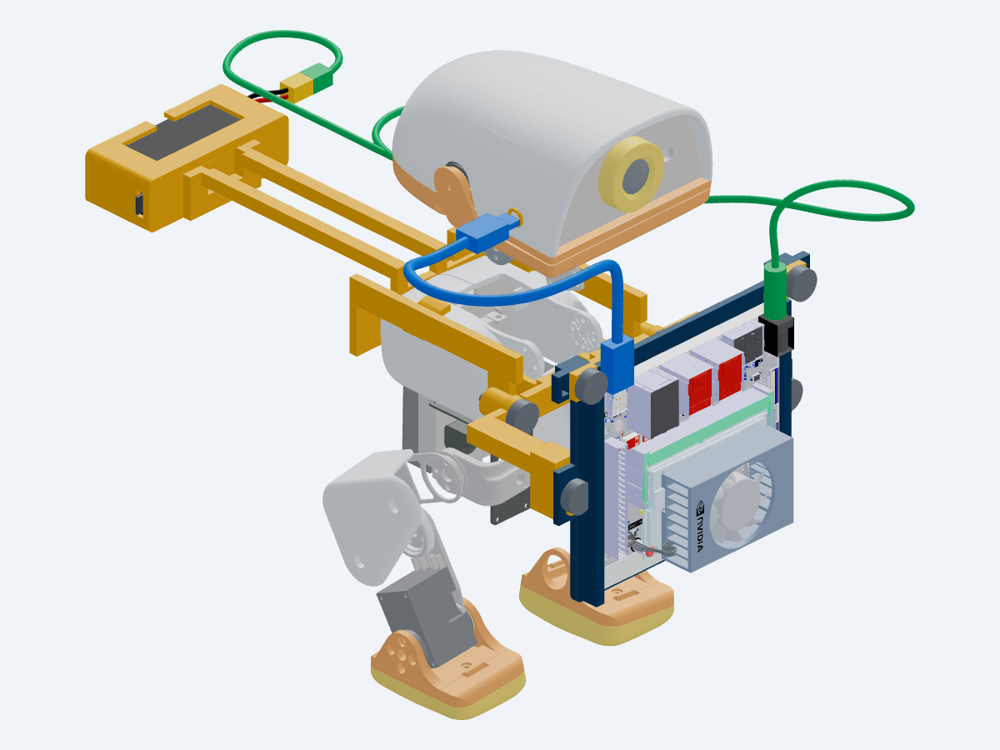
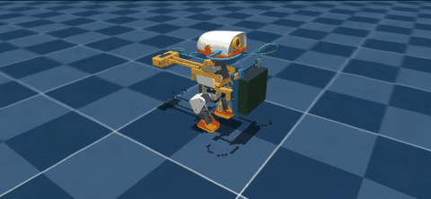
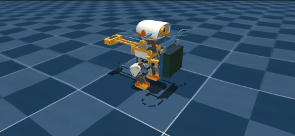
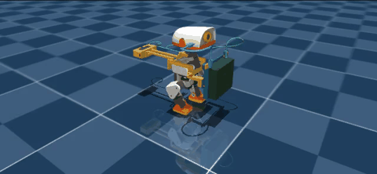
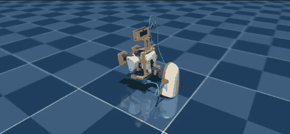
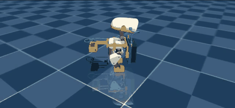
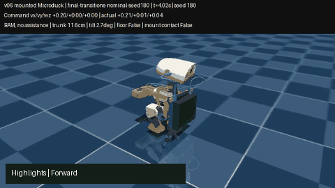
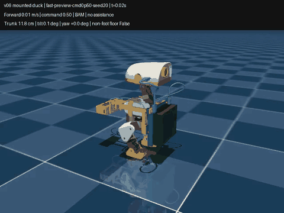
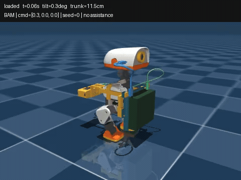

# MicroDuck Jetson Orin Nano mount

Parametric CAD, printable parts, assembled previews and MuJoCo models for an external MicroDuck compute mount. Current design: **v07**, with a raised front Jetson (ports upward) and a raised rear **GNB8504S60AHV 4S LiHV 850 mAh battery**, leaving room for folded legs.



## v07 slope precision and disturbance recovery

[](https://github.com/adammong/microduck-jetson-mount/blob/main/results/robust-v07/recovery-demo.mp4)

The Mac study trains slope precision, push recovery and simulated foot-snag/slip recovery with the current mount included. The candidate has **4.9% lower mean slope tracking error**, changes push-recovery passes **163/192 →152/192**, and trip/slip passes **104/144 →107/144** on fresh paired nominal/randomized tests. The candidate fails the regression guard; the previous terrain controller remains selected. All inherited neural weights remain fixed; observable command/IMU/joint corrections are calibrated on the CPU. A gentler follow-up profile also failed fresh push/trip checks. Harder disturbances still cause falls; this does not enable reliable get-up from the floor.

The video shows the **experimental full candidate (rejected as a replacement)** on 5 mm roughness, with a 4 N side shove, a 2 N right swing-foot force pulse and a 0.35-friction patch. It completes one continuous 15-second run and meets this trial’s safety and recovery criteria. The foot-force pulse is a snag proxy, not a real curb collision. Hardware is untested.

[MP4, top text removed](https://github.com/adammong/microduck-jetson-mount/raw/refs/heads/main/results/robust-v07/recovery-demo.mp4) · [Selected ONNX](results/robust-v07/policies/selected/policy.onnx) · [Candidate](results/robust-v07/policies/candidate/) · [Paired push failure](results/robust-v07/REPORT.md#paired-push-failure-demonstration) · [Measurements and reproduction](results/robust-v07/REPORT.md).

**Try it:** after [setup](training/README.md), run `OMP_NUM_THREADS=1 tmp/microduck-lab/microduck_local/.venv/bin/python training/teleop_motion.py --revision v07 --policy results/robust-v07/policies/selected/policy.onnx --terrain downhill_3deg`, then open http://127.0.0.1:8798.

## v07 uneven-terrain walking

[](https://github.com/adammong/microduck-jetson-mount/blob/main/results/terrain-v07/terrain-demo.mp4)

The Mac terrain study includes the v07 Jetson/battery mount on small bumps, 3°/5° grades and cross slopes, mixed roughness, a beveled 5 mm threshold and low grip. The selected actor passes **1106/1144 direction/contact-qualified 15-second trials** across 13 surfaces and 11 commands; **1144/1144 stay upright**. The trained candidate improves paired passes from **1077 to 1106** while retaining the original neural network. Direction-qualified passes are a broad progress/drift check, not precise tracking. All **16 longer control sequences** complete. Separate starts on rough/sloped ground improve standing/turn direction checks from **44/48 to 45/48**, with both actors staying upright. The candidate regresses slightly on 5° downhill direction checks and some cross-slope turns stall; stairs and hardware are untested. The actor uses existing IMU/joint observations, with no terrain map or vision input. Neutral head pitch and the documented command ramp remain required.

[15-second MP4, top text removed](https://github.com/adammong/microduck-jetson-mount/raw/refs/heads/main/results/terrain-v07/terrain-demo.mp4) · [Selected ONNX](results/terrain-v07/policies/selected/policy.onnx) · [Training, per-surface results and limitations](results/terrain-v07/REPORT.md).

**Try it:** after [setup](training/README.md), run `OMP_NUM_THREADS=1 tmp/microduck-lab/microduck_local/.venv/bin/python training/teleop_motion.py --revision v07 --policy results/terrain-v07/policies/selected/policy.onnx --terrain bumps_5mm --terrain-seed 700`, then open http://127.0.0.1:8798. Other surfaces include `uphill_3deg`, `cross_left_3deg` and `mixed_5mm_3deg`.

## v07 sitting, standing and walking

[](https://github.com/adammong/microduck-jetson-mount/blob/main/results/posture-v07/sitstand-demo.mp4)

The revised mount and calibrated posture policy pass **16/16 fresh sit/stand cycles** with collisions active, including noise, randomized physics and ±10% payload mass. The adapted walking policy passes **88/88 fresh 15-second trials** across 11 movement/stop commands. These are limited simulation tests. Head pitch stays neutral, and the two policies have separate command interfaces; automatic switching is not enabled.

The mount uses removable front hooks and thumb screws; the Jetson's OEM base slides into a separate removable tray. Estimated payload is **447.6 g**, about **5.5 g more than v06**. General fall recovery remains unreliable: the new candidate matches the official baseline at **1/64 synthetic fallen starts** and **11/16 recorded fall poses**; many recordings are upright collapsed poses. It is rejected as a general recovery policy. Hardware fit, strength and performance are untested.

[19-second MP4, top text removed](https://github.com/adammong/microduck-jetson-mount/raw/refs/heads/main/results/posture-v07/sitstand-demo.mp4) · [Sit/stand ONNX](results/posture-v07/policies/sitstand/policy.onnx) · [Walking ONNX](results/posture-v07/policies/walking-adjusted/policy.onnx) · [Tests and reproduction](results/posture-v07/REPORT.md) · [Assembly and print files](clearance_mount/README.md).

**Try walking on the Mac:** after [setup](training/README.md), run `OMP_NUM_THREADS=1 tmp/microduck-lab/microduck_local/.venv/bin/python training/teleop_motion.py --revision v07 --policy results/posture-v07/policies/walking-adjusted/policy.onnx`, then open http://127.0.0.1:8798. W/S, A/D and Q/E move/turn; Space stops. The earlier v06 studies below remain historical comparisons.

## v06 sit/stand and floor recovery — previous mount

[](https://github.com/adammong/microduck-jetson-mount/blob/main/results/posture-v06/front-recovery-success.mp4)

The trained recovery candidate improves paired front-recovery tests from **3/16 to 14/16** with the v06 mount and collisions active. **Full sit/stand is still unresolved:** folded feet intersect the front dock, and the battery pocket supports the duck on the floor. Back/side synthetic recovery remains 0/48; a separate recorded-fall test improves only 7/16 → 8/16. This is a limited simulation candidate; hardware is untested and automatic recovery is not enabled.

[Successful MP4](https://github.com/adammong/microduck-jetson-mount/raw/refs/heads/main/results/posture-v06/front-recovery-success.mp4) · [Failed MP4](https://github.com/adammong/microduck-jetson-mount/raw/refs/heads/main/results/posture-v06/front-recovery-failure.mp4) · [Sit/stand interference](https://github.com/adammong/microduck-jetson-mount/raw/refs/heads/main/results/posture-v06/sitstand-interference.mp4) · [Candidate ONNX](results/posture-v06/policies/front-recovery-candidate/policy.onnx) · [Measurements and reproduction](results/posture-v06/REPORT.md).

## v06 slow movement, stopping and push recovery

[](https://github.com/adammong/microduck-jetson-mount/blob/main/results/precision-v06/motion-demo.mp4)

With the **v06 mount included**, the new controller reduces average slow-command tracking error by **45%**. It passed **464/464 non-push trials** and **16/16 full control sequences** without detected contacts. Push survival improved modestly from **74% to 77%**; stronger pushes still cause falls or contacts. Slow turns now work down to ±0.10 rad/s. Tiny translations still stall. Stopping settled in every slow trial, taking a median 0.56 seconds and up to 1.60 seconds; stopping distance remains variable. Hardware is untested.

**Try it:** after [setup](training/README.md), run `OMP_NUM_THREADS=1 tmp/microduck-lab/microduck_local/.venv/bin/python training/teleop_motion.py --policy results/precision-v06/policies/selected/policy.onnx`, then open http://127.0.0.1:8798. Use W/S, A/D, Q/E and Space. The **Speed** slider scales commands; try 50% for translations and 25% for turns. This actor requires the gentler command ramp read automatically by the local controller.

[Full 35-second MP4](https://github.com/adammong/microduck-jetson-mount/raw/refs/heads/main/results/precision-v06/motion-demo.mp4) · [15-second MP4, top text removed](https://github.com/adammong/microduck-jetson-mount/raw/refs/heads/main/results/precision-v06/policy-15s.mp4) · [Selected ONNX](results/precision-v06/policies/selected/policy.onnx) · [Measurements and limitations](results/precision-v06/REPORT.md). The continuous GIF/short clip shows slow right turning, stopping and two 4 N side pushes in simulation.

## v06 directional control

[](https://github.com/adammong/microduck-jetson-mount/blob/main/results/motion-v06/motion-demo.mp4)

The new **Mac-calibrated directional policy** supports forward/backward, sidesteps, turns, diagonals and curves. It passed **176/176 fresh 30-second simulation trials** with the v06 payload, including observation noise and randomized physics, plus **8/8 complete 69-second control sequences**, with no detected mount contacts. Direction tracking is checked separately from staying upright. Forward/backward presets are +0.20/-0.15 m/s, sideways ±0.10 m/s and turns ±0.40 rad/s. Low-speed commands can still hit the inherited dead zone; hardware is untested.

**Try it on the Mac:** after [setup](training/README.md), run `OMP_NUM_THREADS=1 tmp/microduck-lab/microduck_local/.venv/bin/python training/teleop_motion.py`, then open http://127.0.0.1:8798. Hold **W/S** forward/back, **A/D** sideways, **Q/E** turn; **Space** stops. Movement and turn keys combine into curves. The control page includes command ramps, stale-command stopping and reset.

[Full directional video](https://github.com/adammong/microduck-jetson-mount/raw/refs/heads/main/results/motion-v06/motion-demo.mp4) · [Selected ONNX](results/motion-v06/policies/selected/policy.onnx) · [Measurements, training and limitations](results/motion-v06/REPORT.md).

## v06 faster walking video

[](https://github.com/adammong/microduck-jetson-mount/blob/main/results/speed-v06/fast-walking.mp4)

**New Mac-trained fast-walking policy:** about **0.27 m/s**, roughly **59% faster** than the original policy's successful normal walks. It survived **16/16 fresh 30-second trials**, including observation noise and randomized physics, with no detected mount contacts. Four start/stop sequences also survived. The selected policy retains the original walking network and adds small trained gyro/gravity corrections; both PPO fine-tunes remain rejected.

[Watch the fast-walking MP4](https://github.com/adammong/microduck-jetson-mount/raw/refs/heads/main/results/speed-v06/fast-walking.mp4) · [Selected ONNX policy](results/speed-v06/policies/selected/policy.onnx) · [Measurements, limits and reproduction](results/speed-v06/REPORT.md). Tested forward command: `[0.5, 0, 0]`. This is fast walking in simulation; hardware performance and higher-speed running remain unverified.

Original policy comparison:

[](https://github.com/adammong/microduck-jetson-mount/blob/main/results/mac-v06/preview-loaded-forward.mp4)

[Watch or download the full MP4](https://github.com/adammong/microduck-jetson-mount/raw/refs/heads/main/results/mac-v06/preview-loaded-forward.mp4). This is the unchanged official walking policy on the loaded v06 model in Mac MuJoCo simulation, with no assistance; it is not a hardware demonstration. The earlier PPO fine-tunes remain rejected.

## Start here

- [Current assembly, hardware, printing and limitations](clearance_mount/README.md)
- [Previous v06 assembly](easy_mount/README.md)
- [Wiring and compute-board access](easy_mount/WIRING.md)
- [Battery selection and runtime assumptions](easy_mount/battery_selection.json)
- [Complete robot preview](clearance_mount/GLB/microduck_easy_mount_v07.glb)
- [Editable CAD assembly](clearance_mount/STEP/easy_mount_assembly.step)
- [Five print STLs](clearance_mount/STL/)
- [MuJoCo models and validation reports](clearance_mount/simulation/)
- [Mac simulation and training](training/README.md) · [Faster walking results](results/speed-v06/REPORT.md) · [v06 simulation findings](results/mac-v06/REPORT.md) · [historical v05 findings](results/mac-v05/REPORT.md)

The estimated payload is **447.6 g**, including **125.6 g** fully dense PETG and estimated ancillary hardware. The battery is specified at **73 g**, with **12.92 Wh** nominal energy. Runtime arithmetic estimates 22–37 minutes at 15–25 W total Jetson draw, including reserve and conversion losses; it does not predict robot motor runtime.

## Prototype status

Physical shell fit, structural strength, power conditioning/protection and hardware walking are unverified. The v07 results cover the reported sit/stand cycles and walking commands; previous low-speed, push and fast-walking measurements apply to v06. The original teacher and rejected candidates remain available for comparison. Full joint travel has recorded collisions. The blue USB cable ends at a free, unverified head-side plug; the amber ring is a survey marker, not a stock port. Approximate purchased leads/connectors are illustrated. The larger 1100 mAh pack was researched but has **not** been integrated into this CAD.

## Rebuild

Use Python 3.12. From the repository root:

```sh
python3.12 -m venv .venv
.venv/bin/python -m pip install -r requirements.txt
sh clearance_mount/build.sh
```

Only print the five files in `clearance_mount/STL/`. Electronics, battery, wires, knobs and straps are purchased components. CAD dimensions are millimeters; MuJoCo uses meters and kilograms.

See [third-party attribution](THIRD_PARTY.md). Upstream robot assets and NVIDIA geometry retain their respective terms.
